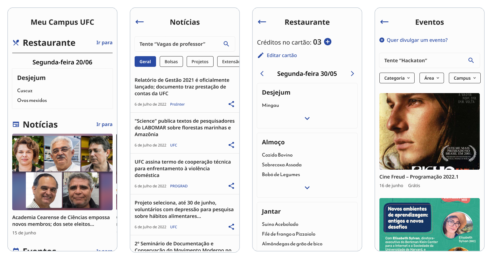

# UFCity: Meu Campus UFC

A mobile app that brings the Federal University of Ceará's restaurant menu, news and events
into one place, because the university's portals break on phones.
Course project (2022) and my B.Sc. thesis in Digital Systems and Media (2024). The app's UI is in Portuguese.

  
   High-fidelity prototype by Erick Gomes, which the app implements.

## The problem

UFC spreads student information across separate portals (news, events, the restaurant
menu, SIGAA), and most of them aren't responsive. In a survey we ran in May–June 2022,
all 57 respondents used a smartphone and 43 of them (75%) had trouble finding information
about the university. Interviews with five students on campus pointed at the restaurant:
checking the day's menu and topping up the meal card.

## What it does

- **Restaurant (RU):** the menu for any day, with previous/next and a date picker. The meal
  card number and student ID are stored on the device with `expo-secure-store`.
- **News:** latest UFC news, keyword search with suggested topics, sharing, and links
  opened in an in-app browser.
- **Events:** events from the UFC agenda.

Checking the card's credits and topping it up by PIX were designed in the prototype, and
the API could look up credits and fetch the payment QR code, but neither was wired into
the app: the top-up screen is a placeholder.

## Team and my role

| Part                                                                                   | Who                                        |
| -------------------------------------------------------------------------------------- | ------------------------------------------ |
| Mobile app (this repository): React Native, Expo, TypeScript                           | Narciso Ferreira                           |
| API and scrapers for the UFC portals: [UFC-API](https://github.com/Spinnafre/UFC-API) | [Davi Silva](https://github.com/Spinnafre) |
| UI/UX design, Figma prototype, usability tests                                         | Erick Gomes                                |

The research (survey, interviews, benchmarking) was done by a five-person team in the
Integrated Project II course, and we also entered the project in UFC's 2022 hackathon.

## Three iterations

Each version was presented at a course checkpoint and tested with users.

| Version               | Commit                                                                                                       | What changed                                                   |
| --------------------- | ------------------------------------------------------------------------------------------------------------ | -------------------------------------------------------------- |
| 1 · 27 May 2022       | [`ac34130`](https://github.com/TheSupereor/UFCity-mobile/commit/ac3413098faf401758f31067c4c498e42f1cd600) | First restaurant and news screens against the early API        |
| 2 · 7 Jul 2022        | [`370b66f`](https://github.com/TheSupereor/UFCity-mobile/commit/370b66f052c5aa6f1861d02fd60734087ecd1e77) | Central menu, events, search with suggestions, richer API data |
| 3 (MVP) · 15 Jul 2022 | [`1e67a99`](https://github.com/TheSupereor/UFCity-mobile/commit/1e67a99784537bb05843788eebebe91334a35ab0) | Home previews, in-app browser, final UI                        |

## What testing showed

Five students used the MVP in person to find a news item, check the day's menu and find
an upcoming event, followed by short interviews. They found the expandable menu unfamiliar,
icons without labels ambiguous, and didn't notice the menu's date or that its cards expand.
The changes we proposed: a conventional home with shortcuts, labelled icons, and stronger
visual cues on the menu.

## Working against unreliable sources

Every piece of data was scraped from UFC's websites, so the app had to live with sources
that went away:

- The API ran on Heroku's free tier, which put apps to sleep after 30 idle minutes. The
  API was kept awake with a scheduled request, and the app fell back to bundled mock data.
- UFC took its news and events portals offline during the 2022 electoral period
  (2 July – 30 October), so the final presentation ran on mock data.

## Status

Archived. This is the MVP as presented in July 2022. It was never published to the
stores, and the API's Heroku apps are no longer online, so the app doesn't load live data.

## Looking back

- Events: the response check is inverted (`if (response.ok)`), so live events never
  replaced the mock data.
- The RU screen mutates the selected `Date` in place, so React doesn't see the change;
  the `setTimeout` was hiding that.
- A suggestion chip searches with the previous text (stale state in a closure).
- The mock fallbacks are copied screen by screen. One data layer with a last-known-good
  cache, which the thesis already proposed, would have survived both outages.
- API URLs are hard-coded in six components instead of coming from configuration, and
  there are no tests beyond the Expo template's.

## Thesis

Menezes Filho, N. F. _UFCity: desenvolvimento de um aplicativo móvel para integração das
informações dos portais de comunicação da Universidade Federal do Ceará, campus do Pici._
B.Sc. thesis, Digital Systems and Media, UFC, 2024.
[PDF](https://drive.google.com/file/d/1mb8yYNTTBJK-x44-Sz2tQ8hyfDlfMa8z/view?usp=sharing)

## Built with

Expo SDK 45 · React Native 0.68 · TypeScript · React Navigation 6 · expo-secure-store
